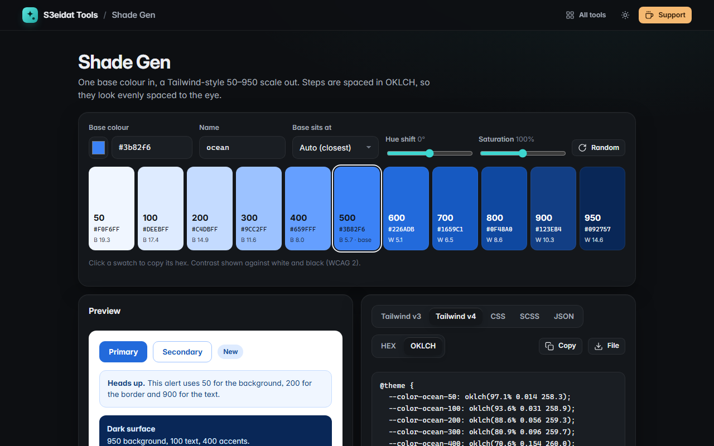

# Shade Gen

> Tailwind-style 50–950 colour scales from one base colour. Free, private, and it runs entirely in your browser.

### ▶ [Open Shade Gen](https://s3eidat.github.io/shade-gen/)



## Features

- One base colour → an **11-step scale** (50, 100 … 900, 950)
- Built in **OKLCH**: lightness follows Tailwind's own curve, so steps look evenly spaced to the eye
- Your colour lands **exactly** on the closest step (or the step you choose); the rest of the curve bends through it
- **Hue shift** for warmer highlights / cooler shadows, and a **saturation** control
- Out-of-gamut steps are brought into sRGB by lowering chroma, keeping lightness and hue
- Each swatch shows its hex and WCAG contrast; click to copy
- **Live UI preview**: buttons, badge, alert and a dark surface using the scale
- Export as **Tailwind v3 config, Tailwind v4 `@theme`, CSS variables, SCSS (with a map) or JSON**, in HEX or OKLCH
- Remembers your last colour and settings

## Privacy

Everything is calculated on your device. There is no server, no account, no analytics.
The page ships with a strict Content-Security-Policy (`connect-src 'self'`), so the browser
itself blocks any attempt to send data anywhere.

## Run it yourself

It's plain HTML, CSS and JavaScript with no build step:

```bash
git clone https://github.com/s3eidat/shade-gen
cd shade-gen
python -m http.server 8000
```

Then open http://localhost:8000.

## Support

If this saved you time, **[buy me a coffee ☕](https://s3eidat.github.io/coffee/)**. It keeps every tool free.

---

Part of **[S3eidat Tools](https://s3eidat.github.io/)**: 100+ free, private tools that run in your browser. MIT licensed.
